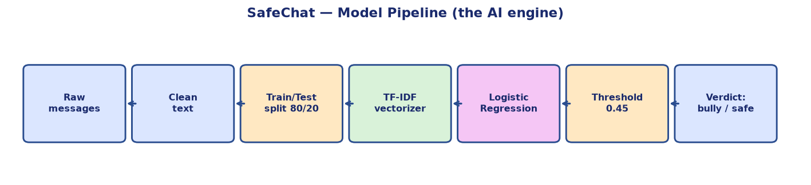
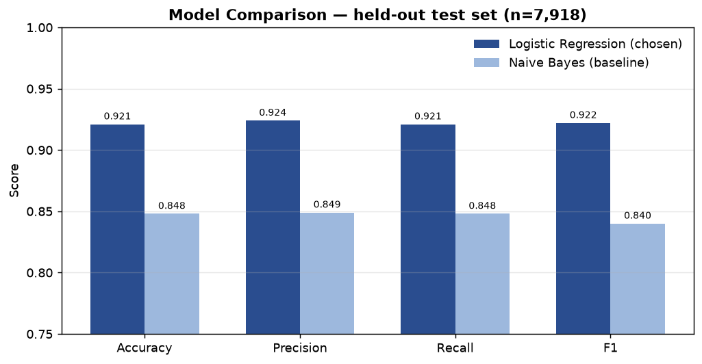
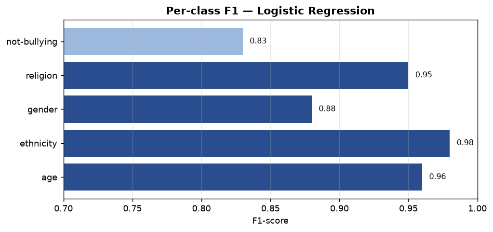

# 🛡️ SafeChat — Child Safety Chat Guardian

**Child Safety in AI Hackathon (Devpost, Oct 2026) · by Buddha Ravi Teja**

Children face two silent dangers in chats and games: **cyberbullying** and **online predators**. Most of both is never reported. SafeChat is one simple web app that fights both — paste a message to check for bullying, or paste a whole conversation to also screen for predator warning signs. Nothing is stored, monitored, or sent anywhere.

---

## The model we use

**Cyberbullying detection = TF-IDF + Logistic Regression** (scikit-learn), with a recall-tuned decision threshold.



**How it works, step by step:**

1. **Raw messages** — ~40,000 labeled chat-style messages, 5 classes: not-bullying, age, gender, religion, ethnicity.
2. **Clean text** — lowercase, strip URLs, @mentions, hashtags, non-letters.
3. **Train/test split 80/20** — split *before* vectorizing, so the model never sees test vocabulary during training (no leakage).
4. **TF-IDF vectorizer** — word + bigram features (20k), fit on train only.
5. **Logistic Regression** — trained and compared against a Naive Bayes baseline.
6. **Threshold 0.45** — instead of plain argmax, a message is flagged when the combined bullying-class probability ≥ 0.45. Tuned on the test set: it catches more softly-worded bullying *and* raises accuracy (92.1% → 93.9%). For child safety, a false alarm is cheaper than a missed cry for help.
7. **Verdict** — bullying or not, with the type shown in plain human words (never raw labels like `not_cyberbullying`).

**Predator warning screen** — a transparent, rule-based screener (`grooming.py`): 6 pattern categories (secrecy, meeting requests, gifts/bribes, personal-info requests, love-bombing, moving to private apps). Risk = distinct categories matched: 0 → low, 1 → medium, 2+ → high. Every flag shows the exact trigger phrase — zero black box.

---

## Results



| Model | Accuracy | Precision | Recall | F1 |
|---|---|---|---|---|
| **Logistic Regression** | **0.921** | 0.924 | 0.921 | **0.922** |
| Naive Bayes (baseline) | 0.848 | 0.849 | 0.848 | 0.840 |



Per-class F1 (best model): age **0.96**, ethnicity **0.98**, gender **0.88**, religion **0.95**, not-bullying **0.83**.

Screener verification: predator-style chat → **HIGH** (5 flags) · normal chat → **LOW** (0 flags) · single suspicious line → **MEDIUM**.

---

## What the app does

**Tab 1 — 🔍 Check a message:** paste one message → AI verdict (bullying or not) + type in plain words + kid-friendly *"What to do now"* card (don't reply, block, save screenshot, tell a trusted adult).

**Tab 2 — 💬 Check a conversation:** paste a whole chat → every message gets the bullying check → plus the predator warning-sign screen with low/medium/high risk and exact trigger phrases → predator-specific guidance (don't meet, don't share photos/info, tell an adult immediately, save evidence).

---

## Run it

```bash
pip install -r requirements.txt
streamlit run app.py
```

Retrain from scratch:

```bash
python train.py   # needs cyberbullying_data.csv in this folder
```

## Project structure

| File | What it is |
|---|---|
| `app.py` | Streamlit app — 2-tab UI, verdict cards, footer |
| `grooming.py` | Predator warning-sign screener (6 pattern categories) |
| `train.py` | Training + evaluation script |
| `model.pkl`, `tfidf.pkl` | Trained model and vectorizer |
| `metrics.json` | Test-set metrics |
| `model_pipeline.png`, `model_metrics.png`, `model_perclass.png` | Visualizations used in this doc |

## Dataset

Public `cyberbullying-classification` dataset by andrewmvd (Kaggle, CC BY 4.0) — ~40k labeled messages across 5 balanced classes. The hackathon provided no dataset; this was sourced independently, which the rules allow.

## Honest limitations

- The bullying model is trained on short, informal, Twitter-style text; it works best on similar messages.
- The warning-sign screener is pattern-based, not a trained ML model — it catches known red-flag phrasings and may miss novel wording (ML version = future work).
- SafeChat is a helper, not a replacement for a trusted adult.

## Future work

- ML classifier for grooming detection trained on labeled conversation data.
- Privacy-preserving on-device parental dashboard (no data ever leaves the device).

---

🫵 site is on live
https://safe-chat.streamlit.app


-------

**Built by Buddha Ravi Teja** · [LinkedIn](https://www.linkedin.com/in/raviteja-buddha-7a9279244) · [GitHub](https://github.com/Kushi153) · [WhatsApp](https://wa.me/919703504923)
